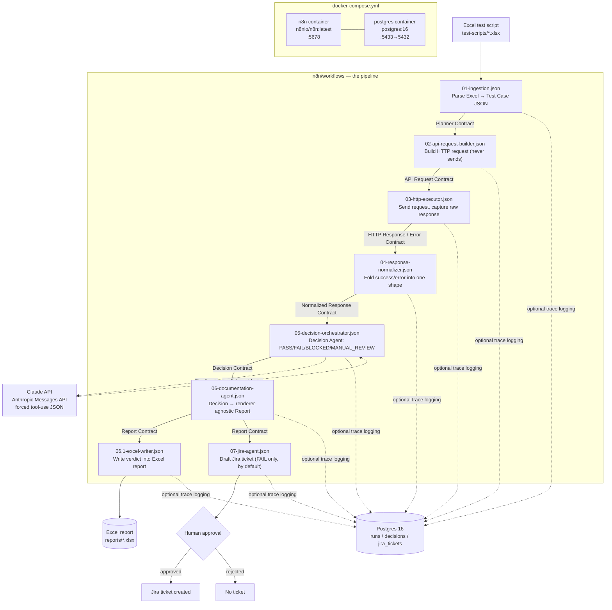
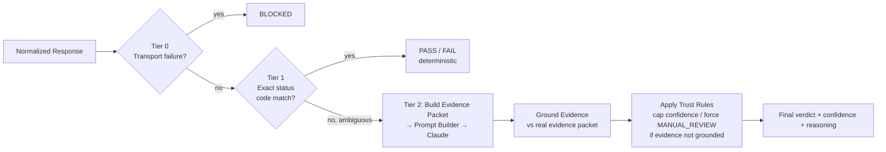

# qa-test-agent — Project Overview

A from-scratch onboarding doc: what this project is, how it runs, and how data flows through it. Written for someone who has never opened this repo before.

---

## 1. What this project is

**qa-test-agent** is an AI-assisted QA automation pipeline built entirely on **n8n** (a visual workflow engine), not a custom backend app.

You give it an Excel test script (test ID, description, steps, expected result). It:
1. Parses the Excel file into structured test cases.
2. Builds and sends the real HTTP request for each test case against a target API.
3. Normalizes the raw response.
4. Judges the result as `PASS` / `FAIL` / `BLOCKED` / `MANUAL_REVIEW` — deterministically where possible, via Claude (Anthropic) only when genuinely ambiguous.
5. Writes the verdict back into the Excel report (specific columns only, original test definition untouched).
6. Drafts a Jira ticket for failures — **never auto-creates it**; a human approval step is a hard gate before anything is created in Jira.

There is **no custom backend framework, no frontend, and no CI/CD** in this repo. n8n itself is the server/runtime; all "application code" is JavaScript inside n8n Code nodes, committed as exported workflow JSON files.

> ⚠️ **Project status (as of last commit):** Tasks 1–6 are built and unit-verified via a script harness that extracts each workflow's JS and runs it against fixtures — but **no workflow has been imported into a live n8n instance yet**, and the real Anthropic API call has only ever been mocked (local testing used Ollama instead). Treat this as "logic complete, integration unverified."

---

## 2. Flow diagram



**Decision Agent internal funnel (inside `05-decision-orchestrator.json`):**



---

## 3. Repository layout

```
QA-Engineer/
├── .env.example              # config template (real .env is gitignored)
├── docker-compose.yml        # the only infra definition: n8n + postgres
├── README.md                 # quickstart + task status
├── AI_MEMORY.md              # narrative build log / gotchas
├── PROJECT_STATUS.md         # per-task status & verification table
├── db/
│   └── init/001_init_schema.sql   # Postgres schema, auto-run on container init
├── docs/
│   ├── architecture/
│   │   ├── milestone-1.md             # full system design
│   │   ├── repository-design.md       # conventions & layout rationale
│   │   ├── decision-agent-design.md   # Decision Agent design (tiers, evidence, confidence math)
│   │   └── decisions/                 # ADRs 001–005
│   ├── contracts/             # one .md per JSON contract passed between workflows
│   ├── renderers/excel-renderer.md
│   ├── reviews/                # self-review reports per task
│   └── workflow-standards.md   # n8n node/naming/validation conventions
├── n8n/
│   ├── workflows/               # the actual pipeline — exported n8n workflow JSON
│   └── credentials.example.json # credential *shapes* only, no real secrets
├── prompts/
│   └── decision-agent/v1.md    # the LLM prompt used by the Decision Agent
├── reports/                     # generated Excel reports land here (gitignored)
└── test-scripts/samples/        # sample/fixture .xlsx files for testing ingestion
```

---

## 4. The pipeline, stage by stage

| # | Workflow file | Job | Talks to AI? |
|---|---|---|---|
| 1 | `01-ingestion.json` | Parses uploaded Excel into a canonical Test Case JSON, dedupes, tags metadata | No |
| 2 | `02-api-request-builder.json` | Builds the HTTP request + auth — **prepares only, never sends** | No |
| 3 | `03-http-executor.json` | Actually sends the request, captures raw response or network error | No |
| 4 | `04-response-normalizer.json` | Folds success/failure into one stable shape for the Decision Agent | No |
| 5 | `05-decision-orchestrator.json` | **The Decision Agent.** 3-tier verdict funnel (see diagram above) | Only Tier 2 (ambiguous cases) |
| 6 | `06-documentation-agent.json` | Formats a Decision Contract into a renderer-agnostic Report Contract | No |
| 7 | `06.1-excel-writer.json` | First renderer: read-modify-write verdict into the Excel report | No |
| 8 | `07-jira-agent.json` | Drafts a Jira ticket for `FAIL` (optionally `MANUAL_REVIEW`), gated on human approval | No |

Workflows only ever exchange **documented JSON contracts** (`docs/contracts/*.md`) — never ad-hoc data shapes. Each contract doc lists its producer, consumer(s), and version.

Design rule enforced throughout: **only the Decision Agent judges pass/fail.** Every other workflow is explicitly "formatting only" — no re-judgment, no AI call, no renderer-specific logic leaking upstream.

---

## 5. The AI layer (Decision Agent)

- **Model:** Anthropic Claude, called via n8n's generic HTTP Request node against the Messages API (deliberately *not* a LangChain/AI-specific n8n node).
- **Structured output:** forced tool-use with a fixed JSON Schema (`status` / `confidence` / `reasoning` / `evidence`) — the model cannot return free-form prose. This is both a reliability mechanism and a partial prompt-injection mitigation.
- **Prompt:** `prompts/decision-agent/v1.md` — versioned (a change becomes `v2.md`, never overwritten in place). Contains the system prompt, output schema, 6 grounding/behavior rules, and 3 few-shot examples.
- **Confidence & Trust Layer** (`Validate AI Response Shape` → `Ground Evidence` → `Apply Trust Rules`): parses each evidence string the model cites, structurally checks it against the real evidence packet it was given, caps confidence for partial grounding, and forces `MANUAL_REVIEW` if evidence is fully ungrounded.

**Known limitation** (documented in `docs/reviews/task-4.5-verification.md`): the grounding check is **structural, not semantic**. A real reproduced case showed the model citing 100%-correct, fully grounded evidence yet still reaching the wrong verdict — self-contradicting its own reasoning — which the Trust Layer cannot catch, because nothing about it is structurally invalid. Don't take AI verdicts as ground truth without spot-checking.

---

## 6. Database (Postgres)

- **Image:** `postgres:16`, used purely for **logging/traceability** — it is not application state, and there's deliberately no ORM or migration framework (two tables don't need Alembic).
- **Schema:** `db/init/001_init_schema.sql`, auto-applied on first container start via the mounted `docker-entrypoint-initdb.d` volume.

| Table | Purpose | Key columns |
|---|---|---|
| `runs` | One row per pipeline execution | `run_id (UUID PK)`, `started_at`, `source_file`, `workflow_version`, `repo_commit` |
| `decisions` | One row per test case verdict | `run_id (FK)`, `test_id`, `status` (CHECK: PASS/FAIL/BLOCKED/NOT_RUN), `confidence`, `reasoning`, `evidence (JSONB)`, `jira_key`, `human_verdict` |
| `jira_tickets` | Dedup index for the Jira Agent | `test_id (PK)`, `jira_key`, `status` (open/closed) |

⚠️ **Known drift:** the `decisions.status` CHECK constraint still lists `NOT_RUN`, which project docs (ADR 005) say was superseded by `MANUAL_REVIEW`. Worth fixing before relying on that column.

---

## 7. Docker setup

Single `docker-compose.yml`, two services, no custom Dockerfile currently in the repo:

```yaml
services:
  n8n:
    image: n8nio/n8n:latest
    ports: ["5678:5678"]
    environment:
      - N8N_BASIC_AUTH_ACTIVE=true
      - N8N_BASIC_AUTH_USER=${N8N_BASIC_AUTH_USER}
      - N8N_BASIC_AUTH_PASSWORD=${N8N_BASIC_AUTH_PASSWORD}
      - N8N_RESTRICT_FILE_ACCESS_TO=/data/test-scripts;/data/reports
    volumes:
      - n8n_data:/home/node/.n8n
      - ./reports:/data/reports
      - ./test-scripts:/data/test-scripts
    depends_on: [postgres]

  postgres:
    image: postgres:16
    environment:
      - POSTGRES_DB=${POSTGRES_DB}
      - POSTGRES_USER=${POSTGRES_USER}
      - POSTGRES_PASSWORD=${POSTGRES_PASSWORD}
    ports: ["5433:5432"]
    volumes:
      - pg_data:/var/lib/postgresql/data
      - ./db/init:/docker-entrypoint-initdb.d

volumes:
  n8n_data:
  pg_data:
```

- **n8n UI:** `http://localhost:5678` (login = `N8N_BASIC_AUTH_USER`/`PASSWORD` from `.env`).
- **Postgres:** host port `5433` → container `5432` (shifted to avoid clashing with a local Postgres install).
- File exchange with n8n happens through bind mounts: drop test scripts in `./test-scripts`, generated reports appear in `./reports`.

---

## 8. Environment variables (`.env`, from `.env.example`)

```
N8N_BASIC_AUTH_USER=admin
N8N_BASIC_AUTH_PASSWORD=changeme

POSTGRES_DB=qa_agent
POSTGRES_USER=qa_agent
POSTGRES_PASSWORD=changeme

ANTHROPIC_API_KEY=

SWAGGER_BASE_URL=
SWAGGER_SPEC_URL=

API_AUTH_BEARER_TOKEN=
API_AUTH_API_KEY_HEADER=X-API-Key
API_AUTH_API_KEY_VALUE=

JIRA_BASE_URL=
JIRA_EMAIL=
JIRA_API_TOKEN=
JIRA_PROJECT_KEY=
```

Note: `ANTHROPIC_API_KEY` is listed here, but the actual Claude HTTP node reads its key from an **n8n Header Auth credential** entered through the n8n UI (encrypted credential store), not from `$env` — see `n8n/credentials.example.json`. The `API_AUTH_*` vars *are* read from `$env` by the HTTP Executor — a documented placeholder pending a move to n8n's credential store once there are multiple target APIs.

---

## 9. Running it locally

```bash
git clone <this-repo>
cd qa-test-agent
cp .env.example .env
# fill in real values: n8n auth, Postgres creds, API keys

docker compose up -d
```

Then:
1. Open `http://localhost:5678`, log in with your `.env` credentials.
2. Import the workflow JSON files from `n8n/workflows/` via the n8n UI (in numeric order — they wire together by name).
3. Drop a test script into `test-scripts/` (see `test-scripts/samples/*.xlsx` for the expected format).
4. Trigger the ingestion workflow; results land in `reports/`.

There is no `package.json`/Makefile — this is the full run procedure. There's also no CI/CD (`.github/workflows` does not exist) and no automated test suite in the conventional sense; verification so far has been done by extracting each workflow's Code-node JS and running it against fixtures in a script harness (see `PROJECT_STATUS.md` for pass/fail counts per task).

---

## 10. Where to go deeper

| Question | Read |
|---|---|
| Full original system design & goals | `docs/architecture/milestone-1.md` |
| Why n8n, why Postgres, why no ORM, etc. | `docs/architecture/decisions/` (ADRs 001–005) |
| Exact shape of data passed between workflows | `docs/contracts/*.md` |
| Decision Agent's reasoning/confidence design | `docs/architecture/decision-agent-design.md` |
| The actual LLM prompt | `prompts/decision-agent/v1.md` |
| How the Excel renderer maps columns | `docs/renderers/excel-renderer.md` |
| Build history, gotchas, lessons learned | `AI_MEMORY.md` |
| What's done vs. still open | `PROJECT_STATUS.md` |
