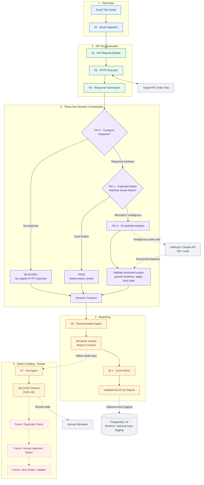
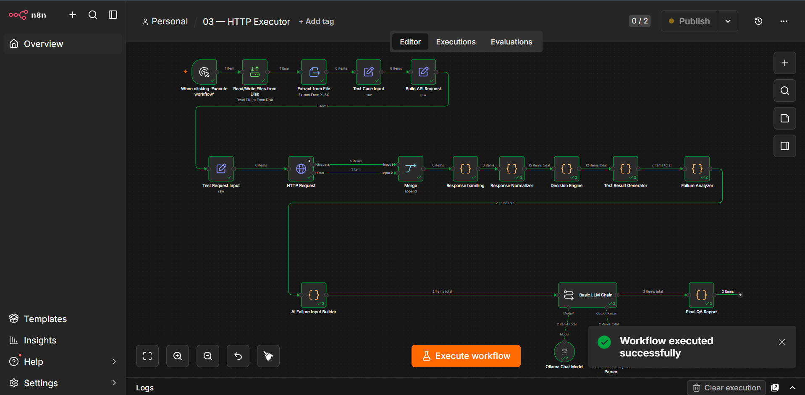
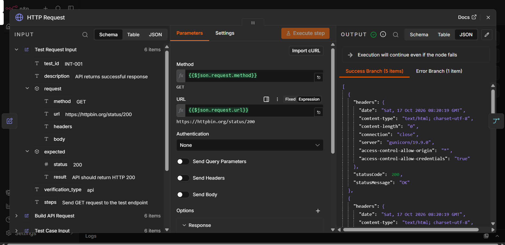
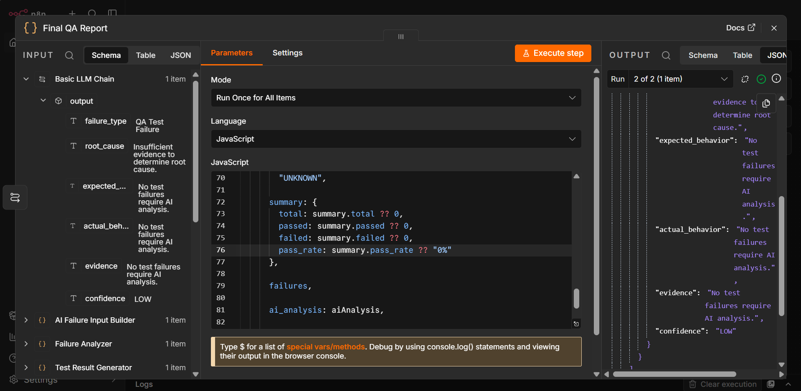

# QA Engineer — AI-assisted API testing and QA reporting

**An AI-assisted API testing and QA reporting pipeline built with n8n, PostgreSQL, Excel, and a guarded LLM decision layer.**

QA Test Agent is a workflow-automation project that turns structured Excel API test cases into normalized test inputs, executes HTTP requests, evaluates actual responses against expected behavior, and prepares consistent QA reports. For potential failures, it can generate a structured Jira ticket draft for review.

The design separates **execution, verdicts, reporting, and ticket preparation** into distinct stages. Deterministic checks handle clear outcomes first; AI is reserved for cases requiring interpretation. The system uses versioned JSON contracts between workflows so that each stage has a clearly defined input and output.

> **Project status:** The workflow definitions and contract chain are implemented and have been extensively checked using script-based harnesses. The repository’s status and infrastructure notes document remaining live-integration gaps. In particular, the full committed pipeline is not yet verified as an end-to-end run inside a configured n8n instance, the real Anthropic API path remains unverified, Excel file I/O still needs validation in n8n, and Jira issue creation is not implemented. This is an engineering project/prototype, not a claim of production deployment.

## At a glance

- **Problem:** Manual API test execution, result interpretation, report updates, and bug-ticket preparation are fragmented and repetitive.
- **Approach:** Versioned n8n workflows, shared JSON contracts, deterministic validation, an AI-assisted decision stage, and human-gated Jira workflow extension points.
- **Current scope:** API-level test cases supplied in Excel.
- **Core technologies:** n8n, Docker Compose, PostgreSQL, JavaScript in n8n Code nodes, Excel/XLSX workflows, Anthropic API integration design, and Jira integration design.
- **Design priorities:** Traceable evidence, explicit error payloads, bounded AI output, reproducible transformations, preservation of test definitions, and human oversight.

## Workflow overview

The architecture below reflects the repository's **current workflow design** and separates implemented workflow stages from integrations that remain unfinished. The diagram is organized into readable stages rather than one long horizontal pipeline.



**How to read the diagram**

1. **Ingestion and execution:** Excel rows become test-case inputs, request contracts, HTTP calls, and normalized response records.
2. **Decision engine:** Tier 0 returns `BLOCKED` when no usable HTTP response exists. Tier 1 returns `PASS` for an exact expected/actual status-code match. Tier 2 sends cases requiring interpretation to the AI-assisted path, then validates the structured response, grounds evidence, and applies trust rules.
3. **Reporting:** The Documentation Agent creates a renderer-neutral Report Contract. The separate `06.1 · Excel Writer` maps report fields into the workbook.
4. **Defect drafting:** The Jira Agent creates a deterministic Jira Draft Contract for eligible cases. The duplicate-check, approval/rejection, and Jira create/update steps are **future extension points**, not working integrations.
5. **Infrastructure boundary:** PostgreSQL schema and Compose configuration are included, but the diagram does not imply that complete live trace logging has been verified.

> **Implementation status:** This diagram represents the workflow definitions and intended data flow, not proof of a fully verified end-to-end deployment. Live n8n Excel I/O and the real Anthropic API path still require integration verification. Jira duplicate checking, human approval, and live issue creation are not implemented.


## Demonstrated local n8n run

The following screenshots are from a successful execution in the author's local n8n instance. They document the workflow canvas, HTTP Executor output, and Final QA Report node.

### Workflow at a glance



*The visible workflow connects Excel ingestion and request building to HTTP execution, response handling/normalization, decision logic, failure analysis, the local Ollama model path, and the Final QA Report node.*

### HTTP Executor: response and transport-error handling



The captured run shows **5 items on the success branch and 1 item on the error branch**. The HTTP responses include status codes **200, 201, 401, 500, and 204**; the deliberately unreachable endpoint returns `ECONNREFUSED`. HTTP status errors such as `401` and `500` are still responses; they should be classified against each test case's expected behavior. A transport failure with no HTTP response is a different condition and should be reported as **BLOCKED**, not automatically as a test failure.

### Final QA Report node



The screenshot confirms that the final node executed and produced a structured output. It does **not**, by itself, verify the final PASS/FAIL/BLOCKED counts or prove that an updated XLSX workbook was written successfully.

### Sample input workbook

Use the committed [QA Agent integration sample workbook](test-scripts/qa_agent_integration_sample.xlsx) as a starting input. Additional valid and invalid workbook fixtures are available in [`test-scripts/samples/`](test-scripts/samples/).

**Evidence boundary:** These images document the shown local n8n run. The committed workflow exports, model/provider configuration, file paths, and native XLSX output behavior may differ from the local instance and still need fresh-clone/end-to-end verification. No generated final output workbook is linked here because one is not currently committed in the repository.

## Key engineering features

### 1. Contract-driven workflow boundaries

Each workflow communicates through a documented JSON contract instead of relying on undocumented fields or free-form text. The contracts cover planner routing, API requests, HTTP responses, normalized responses, decisions, reports, Jira drafts, and errors.

This enables independent validation, more predictable hand-offs, clearer debugging, and controlled contract evolution. Contract and workflow versions are tracked separately where appropriate.

See [Contract catalog](docs/contracts/README.md) and [Workflow standards](docs/workflow-standards.md).

### 2. Deterministic-first decision engine

The decision workflow follows a three-tier funnel:

| Tier | Rule | Outcome | Uses AI? |
|---|---|---|---|
| 0 | No real HTTP response was received, such as a transport failure | `BLOCKED` | No |
| 1 | Parsed expected status code exactly matches actual status code | `PASS` | No |
| 2 | The result needs interpretation beyond the deterministic checks | AI-assisted `PASS`, `FAIL`, or `MANUAL_REVIEW` | Yes |

Keeping unambiguous cases deterministic reduces unnecessary model calls. The AI path uses a constrained structured-output contract, validates the response shape, checks evidence claims against the supplied evidence packet, caps confidence according to deterministic rules, and routes uncertain or ungrounded results to manual review.

**Important limitation:** Evidence grounding verifies that cited fields/values were present in the evidence provided; it does not prove that the model's reasoning is semantically correct. The verification report documents a real local-model example where evidence was grounded but the conclusion was wrong. AI verdicts must therefore remain reviewable.

See [Decision Agent design](docs/architecture/decision-agent-design.md) and [Task 4.5 verification report](docs/reviews/task-4.5-verification.md).

### 3. QA report generation with row-preservation safeguards

The Documentation Agent produces a renderer-neutral Report Contract. The Excel Writer consumes that contract and maps canonical fields to workbook columns in one explicit column map.

The writer is designed to locate an existing row using `Test ID` and update only the nine result/reporting columns. Test definition columns—including `Test ID`, `Description`, `Steps`, and `Expected Result`—are not included in the writer’s update map. It is designed to preserve other rows and unrelated columns, reject missing target rows, and make repeated writes with the same input idempotent.

**Verification boundary:** The workflow’s transformation logic has been tested with a synthetic workbook harness, but the native n8n XLSX read/write nodes have not yet been verified against a real file inside a live n8n execution.

See [Excel renderer design](docs/renderers/excel-renderer.md).

### 4. Jira draft generation with a human-approval boundary

The Jira Agent consumes the Report Contract and creates a deterministic Jira Draft Contract for failures. Manual-review cases are configurable and are not drafted by default. Passing or blocked test cases do not produce a ticket draft.

The current workflow deliberately stops before real Jira submission: duplicate checking, human approval, and create/update nodes are documented extension points. No live Jira issue is created by the current implementation.

### 5. Structured failure handling and traceability

Validation and execution failures use a shared error payload instead of silently dropping a test case. The repository includes PostgreSQL initialization SQL for run, decision, and Jira-ticket tracking, together with Docker Compose setup for local services.

The schema and Compose setup are included as infrastructure foundations; the full logging and live pipeline behavior should be verified during end-to-end integration.

## Repository structure

```text
.
├── n8n/
│   ├── workflows/              # Exported n8n workflow JSON (01–07 and Excel writer)
│   └── credentials.example.json # Shape/documentation only; no real secrets
├── prompts/
│   └── decision-agent/v1.md    # Versioned AI decision prompt
├── docs/
│   ├── architecture/           # System design, milestones, decisions
│   ├── contracts/              # JSON hand-off specifications
│   ├── renderers/              # Excel report-rendering design
│   ├── reviews/                # Verification reports and findings
│   └── workflow-standards.md   # Workflow design and validation conventions
├── db/init/
│   └── 001_init_schema.sql     # PostgreSQL schema initialization
├── test-scripts/
│   ├── qa_agent_integration_sample.xlsx
│   └── samples/                # Valid and invalid sample inputs
├── reports/                    # Local report output location (generated files ignored)
├── .env.example                # Environment-variable template
└── docker-compose.yml          # Local n8n + PostgreSQL services
```

## Technology stack

| Component | Technology | Role |
|---|---|---|
| Workflow orchestration | n8n | Connects ingestion, request, execution, decision, reporting, and Jira-draft stages |
| Local environment | Docker Compose | Runs n8n and PostgreSQL services |
| Logging foundation | PostgreSQL 16 | Schema for run, decision, and Jira-ticket records |
| Workflow logic | JavaScript / n8n Code nodes | Validation, transformations, deterministic checks, contract building |
| Test input and reporting | Excel/XLSX | Source test cases and intended QA result updates |
| AI-assisted interpretation | Anthropic Messages API integration in workflow definition | Handles cases not resolved by deterministic rules; live API verification remains outstanding |
| Issue tracking | Jira REST integration design | Draft contract is implemented; duplicate check, approval, and real submission remain unimplemented |


### Defect lifecycle foundation (in progress)

The additive persistence schema and lifecycle contract have been merged into `main`:

- `db/migrations/002_defect_lifecycle.sql` — defect drafts, active-fingerprint uniqueness, and audit events.
- `docs/architecture/defect-lifecycle.md` — duplicate handling, explicit review states, and submission guard requirements.

The database layer now includes transactional lifecycle functions in `db/migrations/003_defect_lifecycle_functions.sql` and a rollback-only regression script at `tests/sql/defect_lifecycle.sql`. It supports idempotent draft creation, active-fingerprint duplicate detection, explicit approve/reject transitions, append-only audit events, and an APPROVED-only submission-intent guard. The test script is committed but has not yet been executed against a live PostgreSQL instance. n8n workflow wiring, authenticated reviewer endpoints/UI, concurrent integration testing, and the Jira submission adapter remain unfinished; no Jira issue is created. The existing API-testing workflow remains unchanged. See [defect lifecycle design and verification instructions](docs/architecture/defect-lifecycle.md).

## Local setup

### Prerequisites

- Docker Engine and Docker Compose
- Git
- A browser for the n8n editor
- API credentials only for stages you intend to configure and test

### 1. Clone the repository

```bash
git clone https://github.com/Shubhamkumar2703/QA-Engineer.git
cd QA-Engineer
```

### 2. Configure environment variables

```bash
cp .env.example .env
```

Edit `.env` and replace placeholder values with local credentials. The template covers n8n authentication, PostgreSQL, Anthropic, target API authentication, Swagger/OpenAPI URLs, and Jira configuration.

**Never commit `.env`, API tokens, passwords, or exported real credentials.** The committed `n8n/credentials.example.json` is documentation only. Configure actual n8n credentials through the n8n UI.

### 3. Start the services

```bash
docker compose up -d
docker compose ps
```

Open the n8n editor at [http://localhost:5678](http://localhost:5678) and sign in with the credentials configured in `.env`.

PostgreSQL is exposed on host port `5433` and listens on port `5432` inside the container. The initialization SQL is mounted from `db/init/`.

### 4. Import workflows

From the n8n UI, import the relevant JSON files from `n8n/workflows/`. The workflow exports are version-controlled source files; starting Docker does not automatically import them into the n8n editor. Configure required n8n credentials, file permissions/mounts, paths, and environment variables before attempting execution.

The ingestion workflow watches `/data/test-scripts/samples`, which is mounted from the repository’s `test-scripts/` directory. The Excel writer expects an existing workbook at `/data/reports/qa-report.xlsx`; confirm that the input workbook exists and has the documented columns before running that stage.

### 5. Run a controlled test

Start with the supplied sample workbooks and a test API that you own or are authorized to exercise. Verify each stage independently before attempting the entire pipeline. Begin with known expected PASS and FAIL cases, inspect the normalized response and decision contracts, then verify the report row. Treat AI-generated results as recommendations until the configured model and live workflow have been validated.

> The setup steps describe the intended local development loop. They do not imply that a fresh clone currently runs the full pipeline without additional configuration and integration validation.

## Verification and current status

The repository includes task-by-task verification notes and script-based regression harness results. These validate substantial portions of the workflow Code-node logic and contract behavior, but must not be confused with a completed end-to-end production deployment.

| Area | Current status |
|---|---|
| Shared contracts and workflow conventions | Implemented and documented |
| Excel ingestion workflow definition | Built; live n8n execution verification remains outstanding |
| API request builder | Built; live n8n execution verification remains outstanding |
| HTTP executor | Code-node logic checked through a script harness, including real target HTTP responses and transport-failure scenarios; live n8n execution remains outstanding |
| Response normalizer | Script-harness checks documented in project status; live n8n execution remains outstanding |
| Decision orchestrator | Deterministic and AI-path logic checked with harnesses; local Ollama benchmark performed out-of-band; real Anthropic API call and live n8n execution remain unverified |
| Documentation Agent | Script-harness checks documented; live n8n execution remains outstanding |
| Excel Writer | Transformation logic tested with a synthetic workbook harness; actual native XLSX node behavior in live n8n remains unverified |
| Jira Agent | Draft contract generation tested; duplicate-check integration, human-approval implementation, and live Jira submission are not implemented |
| Docker/n8n/PostgreSQL integration | See [Infrastructure validation report](docs/reviews/task-i1-infrastructure-validation.md) for environment-specific blockers and setup gaps |

For detailed task status and verification caveats, read [PROJECT_STATUS.md](PROJECT_STATUS.md) and the reports in [docs/reviews/](docs/reviews/).

## Design documents

- [System architecture and Milestone 1 scope](docs/architecture/milestone-1.md)
- [Repository design](docs/architecture/repository-design.md)
- [Workflow standards](docs/workflow-standards.md)
- [Contracts catalog](docs/contracts/README.md)
- [Decision engine design](docs/architecture/decision-agent-design.md)
- [Excel renderer design](docs/renderers/excel-renderer.md)
- [Current implementation status](PROJECT_STATUS.md)
- [Infrastructure validation](docs/reviews/task-i1-infrastructure-validation.md)
- [AI verification, benchmark, and calibration findings](docs/reviews/task-4.5-verification.md)

## Security and responsible use

- Use only target APIs you own or are authorized to test.
- Store secrets in local environment variables and n8n's credential store; never in workflow JSON, prompts, sample files, or committed documentation.
- Keep sample data sanitized. Do not commit private test scripts, production payloads, access tokens, or personal data.
- The HTTP Executor sends requests to target URLs supplied by test cases; use trusted input workbooks and configure an appropriate test environment.
- AI output is constrained and checked, but grounding is not a guarantee of semantic correctness. Maintain human review for uncertain outcomes and validate model behavior before operational reliance.
- Jira submission is not automated in the current version.

## Roadmap

The documented next steps focus on closing integration and verification gaps before expanding scope:

1. Configure a reproducible local environment, credentials, correct bind mounts, and workflow imports/activation.
2. Run the committed workflows end-to-end in a live n8n instance.
3. Validate actual XLSX read/write behavior with real sample files.
4. Exercise the real Anthropic API path and calibrate decision thresholds on a representative test set.
5. Implement Jira duplicate checking, human approval, and actual Jira submission only after the draft path is verified.
6. Improve semantic-consistency checks and AI-failure recovery based on the documented verification findings.

## Author

**Shubham Kumar**  
GitHub: [@Shubhamkumar2703](https://github.com/Shubhamkumar2703)

---

If you find a bug or have a suggestion, please open a GitHub issue with steps to reproduce, expected behavior, and actual behavior.
